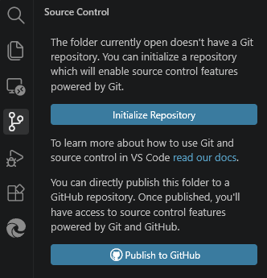
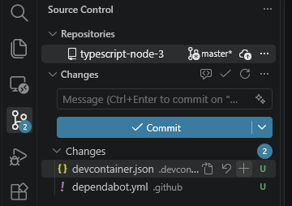
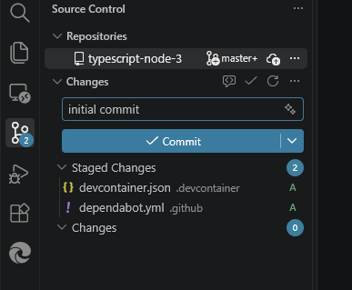
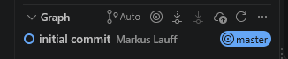
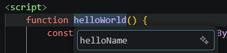
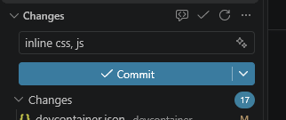
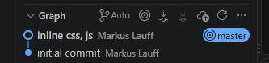
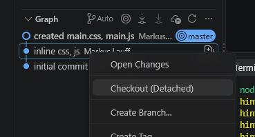
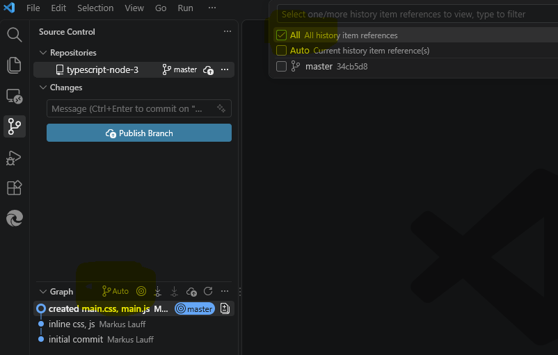

# Recap Linux Terminal, HTML, CSS, JS, Git

## Terminal in VS Code öffnen

- Menüzeile: (`...` >) ` Terminal` > `New Terminal`
- Tastenkombination: `Ctrl-Shift-ö`

## Linux Terminal Commands

| Kommando | Beschreibung |
| --- | --- |
| `ls -al` | Verzeichnisinhalt anzeigen (-a steht für alles, -l für lang) |
| `cd <Verzeichnisnamme>` | Verzeichnis wechseln |
| `cd ..` | In übergeordnetes Verzeichnis wechseln |
| `mkdir <Verzeichnisnamme>` | Verzeichnis erstellen |
| `rmdir <Verzeichnisnamme>` | Verzeichnis löschen |
| `touch <Dateiname>` | Leere Datei erstellen |
| `rm <Dateiname>` | Datei löschen |

#### Weitere Informationen:
- https://linuxcommand.org/index.php
- Google Suche: `linux terminal commands`

## Übung HTML, CSS, JS + Git

### Minimale HTML Datei `index.html` erstellen

```html 
<!DOCTYPE html>
<html lang="de">

<head>
    <meta charset="UTF-8">
    <title>Hallo Welt!</title>
</head>

<body>
    <h1>Hallo Welt!</h1>
</body>

</html>
```

### Vorschau öffnen

- In Datei-Explorer (linke Spalte) mit rechter Maustaste auf Datei klicken und `Show Preview` auswählen.

###  Mit Inline-CSS das Aussehen verändern

```html 
<!DOCTYPE html>
<html lang="de">

<head>
    <meta charset="UTF-8">
    <title>Hallo Welt!</title>
</head>

<style>
    body {
        background-color: yellow;
        padding: 20px;
    }

    h1 {
        color: red;
    }
</style>

<body>
    <h1>Hallo Welt!</h1>
</body>

</html>
```

### Button und inline Javascript für 'Hello World' hinzufügen

```html
<!DOCTYPE html>
<html lang="de">

<head>
    <meta charset="UTF-8">
    <title>Hallo Welt!</title>
</head>

<style>
    body {
        background-color: yellow;
        padding: 20px;
    }

    h1 {
        color: red;
    }

    button {
        background-color: blue;
        color: white;
        padding: 10px 20px;
        width: 90%;
    }
</style>

<body>
    <h1>Hallo Welt!</h1>
    <button onclick="alert('Hallo Welt!')">Klick mich</button>
</body>

</html>
```

### Git initialisieren und Version erstellen

In der linken Symbolleiste `Source Control` auswählen (oder `Ctrl-Shift-G`) und dann `Initialize Repository` auswählen.



**Alternativ** im Terminal den Befehl `git init` ausführen.

Im Bereich `Source Control` die vorhandenen Dateien mit dem +-Zeichen zu `Staged Changes` hinzufügen.



Nachdem die Dateien jetzt unter `Staged Changes` erscheinen, eine erste Version mit einer Commit-Message (z.B. 'initial commit') erstellen.



Die erste Version erscheint jetzt im unteren `Graph-Bereich`.



### Javascript in Inline-Script Bereich verschieben und über Funktion aufrufen

```html
<!DOCTYPE html>
<html lang="de">

<head>
    <meta charset="UTF-8">
    <title>Hallo Welt!</title>
</head>

<style>
    body {
        background-color: yellow;
        padding: 20px;
    }

    h1 {
        color: red;
    }

    button {
        background-color: blue;
        color: white;
        padding: 10px 20px;
        width: 90%;
    }
</style>

<body>
    <h1>Hallo Welt!</h1>
    <button onclick="helloWorld()">Klick mich</button>
</body>

<script>
    function helloWorld() {
        alert('Hallo Welt!');
    }
</script>

</html>
```

### Eingabefeld für Namen hinzufügen und `Hallo <Name>` anzeigen

Die Zeile `const name = document.getElementById('nameInput').value;` liest den im Eingabefeld eingegebenen Namen aus und speichert ihn in der Konstanten `name`.

```html
<!DOCTYPE html>
<html lang="de">

<head>
    <meta charset="UTF-8">
    <title>Hallo Welt!</title>
</head>

<style>
    body {
        background-color: yellow;
        padding: 20px;
    }

    h1 {
        color: red;
    }

    input {
        padding: 10px;
        margin-bottom: 10px;
        width: 90%;
    }

    button {
        background-color: blue;
        color: white;
        padding: 10px 20px;
        width: 90%;
    }
</style>

<body>
    <h1>Hallo Welt!</h1>
    <input type="text" id="nameInput" placeholder="Namen eingeben...">
    <button onclick="helloWorld()">Klick mich</button>
</body>

<script>
    function helloWorld() {
        const name = document.getElementById('nameInput').value;

        if (name) {
            //alert('Hallo ' + name + '!');  // String Concatenation
            alert(`Hallo ${name}!`); // Better: Template Strings (ES6)
        } else {
            alert('Hallo Welt!');
        }
    }
</script>

</html>
```

### Funktion `HelloWorld` in `HelloName` umbenennen

Cursor in Funktionsnamen positionieren und dann `F2`-Taste drücken. 

In dem Eingabefeld neuen Namen eingeben.



VS Code benennt jetzt auch die Verwendung der Funktion (im onclick-Handler) um.

### Neue Version erstellen

In den Source-Bereich wechseln und eine neue Version erstellen (Message zum Beispiel "inline css, js").



**Hinweis:** Wenn alle geänderten Dateien übernommen werden sollen, dann müssen diese nicht (wie vorher beschrieben) mit dem `+`-Zeichen zu den `Staged-Changes` hinzugefügt werden.

Die neue Version erscheint jetzt auch im `Graph-Bereich`.



### Inline CSS / JS in eigene Dateien auslagern.

**Hinweis:** Inline CSS und JS macht das Projekt schnell unübersichtlich. Daher ist es besser diese in eigenen Dateien auszulagern.

#### index.html

```html
<!DOCTYPE html>
<html lang="de">

<head>
    <meta charset="UTF-8">
    <title>Hallo Welt!</title>
</head>

<style>
    @import url('main.css');
</style>

<body>
    <h1>Hallo Welt!</h1>
    <input type="text" id="nameInput" placeholder="Namen eingeben...">
    <button onclick="helloName()">Klick mich</button>
</body>

<script src="main.js"></script>

</html>
```

#### main.css

```css
body {
    background-color: yellow;
    padding: 20px;
}

h1 {
    color: red;
}

input {
    padding: 10px;
    margin-bottom: 10px;
    width: 90%;
}

button {
    background-color: blue;
    color: white;
    padding: 10px 20px;
    width: 90%;
}
```

#### main.js

```js
function helloName() {
    const name = document.getElementById('nameInput').value;

    if (name) {
        //alert('Hallo ' + name + '!');  // String Concatenation
        alert(`Hallo ${name}!`); // Better: Template Strings (ES6)
    } else {
        alert('Hallo Welt!');
    }
}
```

### Neue Version erstellen

In den Source-Bereich wechseln und noch einmal eine neue Version erstellen (Message zum Beispiel "created main.css, main.js").

### Version wechseln

Mit einem Rechsklick auf die Version im 'Graph-Bereich' kann man zu einer (alten) Version wechseln (`checkout`).



**Hinweis:** Danach werden die neueren Versionen ggf. nicht mehr angezeigt. In diesem Fall muss die Ansicht von `Auto` auf `All` umgestellt werden.



